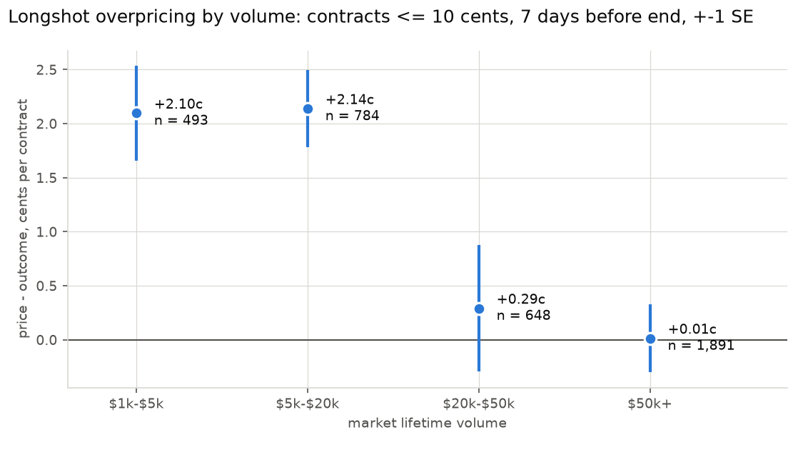
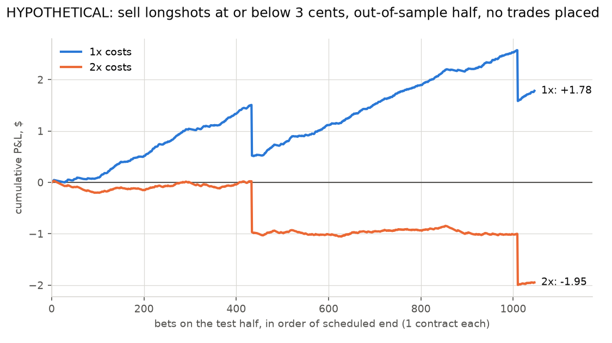
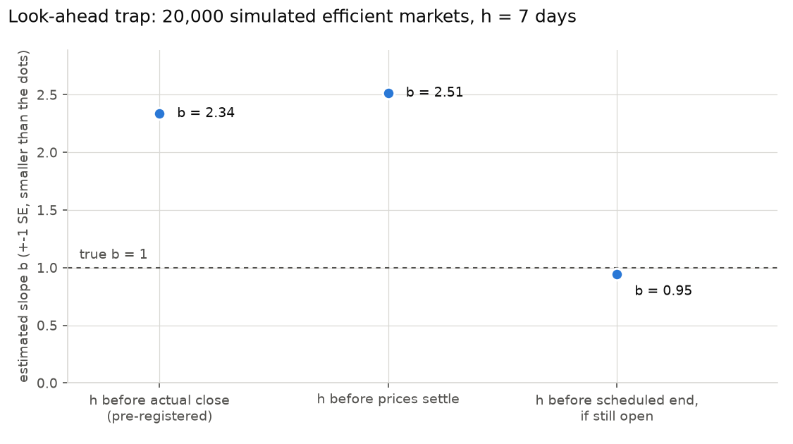

# Where are prediction markets least efficient?

Polymarket prices have a small average calibration error, but statistically detectable departures from
perfect calibration. In a random sample of 10,540 resolved markets (February 2023 to September 2026, up to
1,000 per month), priced 7 days before their scheduled end, the reliability (miscalibration) part of the Brier
score is 0.0008 out of 0.1286; always forecasting the base rate would score 0.2069. Perfect calibration is
still rejected, mainly through a shift (the first-listed outcome wins less often than priced) and a small
favorite-longshot bias: recalibration slope 1.077 (p = 0.0066); contracts at or below 10 cents resolve YES 0.77
cents less often than priced. In markets with at least $50,000 of volume, both disappear. The bias is smaller
than the cost of trading it: a hypothetical rule that sells longshots, tuned on the older half of the sample and
tested once on the newer half, makes +0.17 cents per contract (t = 1.26) at estimated costs and loses money at
twice those costs. Read-only public data; no accounts, no orders.

**Status:** Part 1 (calibration, longshot bias): final. Part 2 (arbitrage, order books): collecting until ~Nov 7.


Primary result in bold; every other row is exploratory (Holm-adjusted p-values within that family) or a
robustness check. Standard errors are clustered by event.

| 7 days before scheduled end | n (events) | Brier | climatology Brier | reliability | slope `b` (SE) | p(`b` = 1), Holm | intercept `a` (SE) | longshots <= 10c: overpricing (SE), n |
|---|---|---|---|---|---|---|---|---|
| **all (primary)** | **10,540 (7,861)** | **0.1286** | **0.2069** | **0.0008** | **1.077 (0.028)** | **0.0066** | **-0.119 (0.028)** | **0.77c (0.21), 3,816** |
| sports | 5,964 (4,901) | 0.1725 | 0.2317 | 0.0010 | 1.002 (0.043) | 0.96, 1.00 | -0.120 (0.032) | 0.21c (0.45), 1,112 |
| politics | 1,991 (1,250) | 0.0606 | 0.1578 | 0.0009 | 1.174 (0.064) | 0.007, 0.15 | -0.019 (0.090) | 0.57c (0.36), 1,233 |
| other | 1,058 (706) | 0.0777 | 0.1733 | 0.0035 | 1.138 (0.075) | 0.065, 1.00 | -0.052 (0.111) | 1.59c (0.44), 606 |
| economics | 661 (449) | 0.0874 | 0.1779 | 0.0025 | 1.078 (0.099) | 0.43, 1.00 | -0.251 (0.134) | 1.11c (0.58), 333 |
| crypto | 435 (271) | 0.0463 | 0.0740 | 0.0091 | 1.167 (0.147) | 0.26, 1.00 | -0.754 (0.221) | 1.60c (0.53), 318 |
| recurring | 341 (250) | 0.1085 | 0.1525 | 0.0053 | 1.123 (0.173) | 0.48, 1.00 | -0.194 (0.212) | 1.26c (0.82), 169 |
| weather | 90 (54) | 0.0937 | 0.2054 | 0.0069 | 0.898 (0.285) | 0.72, 1.00 | -0.057 (0.349) | -1.46c (2.93), 45 |
| robustness: without recurring | 10,199 (7,627) | 0.1292 | 0.2083 | 0.0008 | 1.075 (0.029) | 0.0088 | -0.117 (0.028) | 0.74c (0.21), 3,647 |
| robustness: volume >= $50,000 | 4,611 (3,542) | 0.1209 | 0.2101 | 0.0004 | 0.995 (0.037) | 0.90 | -0.011 (0.044) | 0.01c (0.31), 1,891 |
| robustness: fresh prices only | 8,874 (6,823) | 0.1314 | 0.2116 | 0.0007 | 1.068 (0.030) | 0.024 | -0.119 (0.030) | 0.81c (0.24), 3,067 |
| robustness: fresh, >= $50,000 | 4,049 (3,213) | 0.1258 | 0.2153 | 0.0005 | 0.983 (0.038) | 0.65 | -0.019 (0.046) | -0.08c (0.37), 1,564 |

`logit P(YES) = a + b * logit(price)`: a calibrated market has `a = 0, b = 1`; `b > 1` means longshots are
overpriced. Climatology Brier: the score of always forecasting the sample's base rate (equal to the
uncertainty term). "Fresh": the price changed within the 24 hours before the measuring time.

## About

A read-only measurement study of Polymarket (Kalshi was planned and dropped: its API terms forbid this use,
see "Data and venue terms"). If a contract trades at 70 cents, the market says "70% likely". This project
tests whether those prices can be trusted, and where they break down.

Scope: measurement only. Public read-only data, no accounts, no API keys, no orders. Whatever comes out is
reported, including "these markets are efficient".

## Research questions (written before looking at any results)

This section was committed before any data was downloaded or analysed. Later changes to it are visible in
the git history and are listed under "Changes to plan" below.

### (a) Calibration

When a market says 70%, does it happen about 70% of the time?

- Sample: resolved binary markets (outcome exactly YES or NO; voided or 50/50 resolutions dropped).
  One observation per market: the first listed outcome ("Yes" in yes/no markets) and its price.
- Reference time `T` = the earlier of the scheduled end date and the actual close time. Price at horizon
  `h` = the last recorded price at or before `T - h`, for `h` = 1 day, 7 days and 30 days. The market must
  have a price within the 24 hours before `T - h`; markets younger than `h` at `T` are dropped for that
  horizon. Primary horizon: 7 days. 1 day and 30 days are secondary.
- Main sample: lifetime volume >= $1,000. Robustness: volume >= $50,000.
- Metrics: Brier score with its Murphy decomposition (reliability, resolution, uncertainty); calibration
  curve in 10 equal-width price bins with 95% Wilson intervals; logistic recalibration
  `logit P(YES) = a + b * logit(price)`. A calibrated market has `a = 0, b = 1`; tested jointly with a
  Wald test using standard errors clustered by event (outcomes of one event are not independent).
- By category: sports, politics, economics, weather, crypto, other, assigned from the venue's own tags by
  a fixed mapping in the code (`pm/data.py`).

### (b) Favorite-longshot bias

Are cheap contracts overpriced, as in betting markets?

- Same sample and prices as (a).
- Test: the slope `b` above. `b > 1` means true probabilities are more extreme than prices, i.e. longshots
  are overpriced and favorites underpriced. Two-sided test of `b = 1` at 5%, clustered by event.
- Descriptive: average overpricing of longshots, `mean(price - outcome)` over contracts priced at or below
  10 cents, with an event-clustered standard error.

### (c) Arbitrage inside one venue

How often does buying both YES and NO cost less than $1 after the official fee schedule, the spread and
slippage? How long do these gaps last?

- From order-book snapshots: for each binary market, walk the YES and NO asks to buy `q` of each, add the
  venue's official taker fee for every fill, and compare with the $1 payout. Report the share of snapshots
  with a positive net edge at the smallest allowed order size, the most profitable `q`, and the profit.
- Duration: consecutive snapshots with a positive edge form an episode. With snapshots every `N` minutes a
  duration is known only to within `N` minutes; shorter gaps are mostly missed. This is stated with every
  number.
- Gas and deposit/withdrawal costs are ignored; they can only shrink an edge.

(c') Added at design time, before any data: on both venues a single binary market's YES ask plus NO ask
below $1 implies a crossed book (Polymarket mirrors the YES and NO books; a Kalshi ask is one minus the
opposite bid), so (c) is expected to be close to never. The multi-outcome version is measured as well: for
an event whose outcomes are mutually exclusive and exhaustive, buying YES on every outcome pays exactly $1
(and NO on every outcome pays `n - 1`). Same fee and book-walking rules. Events that can still add outcomes
are excluded, since they are not exhaustive.

### (d) Arbitrage across venues

Is the same event priced differently on Kalshi and Polymarket, after fees?

**Status: closed, not possible under the venue terms.** Kalshi's API Developer Agreement allows API use only
for a member's own trading and forbids collecting or storing its data for any other purpose (see "Data and
venue terms"). Without Kalshi data there is no second venue to compare. The plan below is kept as written.

- Only event pairs whose resolution rules are verified to match: same event, same resolution source, same
  cut-off date and time zone, same treatment of edge cases. The evidence for each pair (both rule texts and
  the comparison) is stored in `pairs/`; pairs with different rules are dropped and listed with the reason.
- Edge: buy YES on one venue and NO on the other at the walked asks plus both venues' taker fees, against
  the $1 payout. Same reporting as (c).

## Validation: every component is tested against a known answer

- Fee calculators reproduce the venues' published fee examples.
- Brier score and calibration on simulated forecasts that are calibrated by construction (must pass) and
  miscalibrated (must be detected).
- Arbitrage detector on synthetic order books with hand-computed edges, including walking the book and fees.
- The bias test rejects about 5% of the time on simulated unbiased markets with the same event clustering.
- The measuring-time rule keeps a simulated efficient market calibrated; a market that resolves early cannot
  leak its outcome into the measured price.
- Capacity at a budget, annualized return against the T-bill yield, the next-snapshot rule and the book sanity
  checks each have a test with a hand-computed answer.
- The longshot-selling P&L, cheaper-side selection and maximum drawdown match hand-computed values, and
  unbiased simulated longshots lose exactly their costs.

## Results

### (a) and (b): calibration and the favorite-longshot bias (final, 2026-10-17)

Table and calibration chart: top of this page. Sample: the 30,666 markets in `results/sample_ids.txt`, drawn
at random, up to 1,000 per month of resolution, from the 1,070,804 resolved Polymarket markets with volume >=
$1,000. Analysed: the complete calendar months February 2023 to September 2026, 26,841 markets with a price
history (October 2026 dropped as incomplete). Primary rule: price 7 days before the scheduled end, market still
open, volume >= $1,000. Months are weighted roughly equally; early months have fewer than 1,000 eligible
markets and are taken whole.

- (a) Brier 0.1286 = reliability 0.0008 - resolution 0.0788 + uncertainty 0.2069; skill against the
  climatology forecast 0.379. Binning barely matters: reliability is 0.0008 with 10 equal-width bins, 0.0011
  with 20, and 0.0009 with 10 equal-count bins (`results/binning_sensitivity.csv`). Perfect calibration is
  rejected (joint test p < 0.0001), mainly through the intercept: in the 0.4-0.5 bin the price averages 0.456
  and the outcome 0.388 (n = 1,345). With volume >= $50,000 the intercept is -0.011 (SE 0.044).
- (b) Small favorite-longshot bias: `b` = 1.077 (SE 0.028, p = 0.0066); longshot overpricing 0.77 cents
  (SE 0.21). It sits in thin markets:



  Overpricing is about 2.1 cents per contract in markets with $1,000-$20,000 of volume and indistinguishable
  from zero above $20,000 (`results/longshot_by_volume.csv`).
- Exploratory (category and horizon): after Holm adjustment no category's or horizon's slope differs from 1
  (smallest: politics at 7 days, p = 0.007, Holm 0.15). Joint tests that survive Holm: sports and crypto at 7
  days, all markets and politics at 1 day, all markets and crypto at 30 days. At 1
  day `b` = 1.029 (p = 0.13); at 30 days `b` = 1.097 (p = 0.033, Holm 0.69).
- Staleness: the median measured price last changed 3 hours before the measuring time; 15.8% had not changed
  for more than 24 hours. Without them the longshot bias remains (0.81 cents, SE 0.24; `b` = 1.068, p = 0.024)
  and the >= $50,000 result remains (`b` = 0.983, p = 0.65; -0.08 cents).
- Recurring machine-generated markets barely matter at 7 days (341 of 10,540); removing them changes nothing.
  Full tables: `results/calibration_summary.csv` (with Holm-adjusted p-values), `results/calibration_bins_7d.csv`.

### Is the longshot bias exploitable? A hypothetical rule (2026-10-17)

Hypothetical only: no orders were placed. Rule: 7 days before the scheduled end, sell every contract quoted at
or below X (each market's cheaper side), as a taker. Costs per contract: half-spread plus taker fee.

- Spreads: historical spreads are not in the data. Order books collected on 2026-10-17 before 16:00 UTC stand
  in for them: mean half-spread 0.24 cents for contracts at or below 2 cents (9,931 books), 1.02 cents at 2-5
  cents (5,644), 2.49 cents at 5-10 cents (8,286). These are active markets (events with >= $10,000 traded in a
  day), so spreads in the historical sample were probably wider. 58% of order books near the extremes were
  one-sided, so often there was nothing to sell into. Fees: today's taker rate for the category (0.04 to
  0.07), applied to every market even though most historical markets charged no fee.
- X chosen on the older half (scheduled end up to 2025-04-07, 5,275 markets) by mean net P&L per bet: X = 3
  cents, +0.05 cents per bet (t = 0.27, 1,941 bets). Every X from 1 to 10 cents was within about one standard
  error of zero.
- Tested once on the newer half (5,265 markets), X = 3 cents:

| costs | bets (events) | mean price | win rate | net P&L per bet (SE) | total, 1 contract per bet | max drawdown |
|---|---|---|---|---|---|---|
| base | 1,046 (832) | 0.72c | 0.19% | +0.17c (0.14), t = 1.26 | +$1.78 | $1.00 |
| 2x | 1,046 (832) | 0.72c | 0.19% | -0.19c (0.13), t = -1.38 | -$1.95 | $2.03 |



The edge is not distinguishable from zero and changes sign when costs double. Two single winning longshots
cause the two steps. With real spreads probably wider, and one-sided books, the measured bias is not a trading
opportunity. `scripts/longshot_rule.py`, `results/longshot_rule.csv`, `results/longshot_rule_test_pnl.csv`.

Look-ahead check (`results/lookahead.csv`): share of measured prices already at >= 0.97 or <= 0.03, 7 days
out. Pre-registered close rule: 34.1% (n = 10,102). Settle rule: 11.3% (n = 8,531). Scheduled rule: 28.4%
(n = 10,540). The scheduled rule still sees many extreme prices: longshots in multi-outcome events, and
outcomes already known while the market is still open. Neither is look-ahead, because the time is fixed in
advance. The other two rules choose the time with hindsight, and on simulated efficient markets they produce a
bias that is not there:



20,000 simulated "will it happen by day 60" markets, calibrated by construction (`pm/sim.py`,
`results/lookahead_simulation.csv`): slope `b` = 2.34 (SE 0.04) measuring 7 days before the actual close,
2.51 (SE 0.04) before prices settle, 0.945 (SE 0.048) before the scheduled end.

### (c) and (c'): arbitrage inside Polymarket (collection started 2026-10-17)

First 81 snapshots (about 2.7 hours): 995,552 single-market checks with no YES + NO gap after fees, as
mirrored books imply. Exhaustive multi-outcome events: 66 gap-snapshots after fees in 14,750 checks,
3 of them above the T-bill hurdle, none still there in the next snapshot. So far: no arbitrage. The
collector keeps running; this section will be updated after 2-3 weeks.

### Superseded: first preliminary results (2026-10-17)

Kept for the record; do not use. Two flaws: the sample was the first markets the API listed (83% resolved in
2025, 217 in 2026), and prices were measured 7 days before the actual close, a rule that looks into the future
(see "Changes to plan"). On that basis: 2,018 markets, Brier 0.0889, slope `b` = 1.138 (SE 0.064, p = 0.032),
longshot overpricing 0.88 cents (SE 0.30).

An error in the first (c') note is corrected here: for "How many Fed rate cuts in 2026?" the $0.0111 edge was
the profit on the minimum order of 5 sets, not on one set: about 0.2 cents per set, 1.1% a year to the
scheduled end, below the 3-month T-bill. It is not an arbitrage under the rules below.

## Data and venue terms

| | Polymarket | Kalshi |
|---|---|---|
| Resolved markets with outcomes | Gamma `GET /markets/keyset?closed=true` | `GET /markets`, `GET /historical/markets` |
| Price history | data-api `GET /v2/prices-history`: 3-hour and 12-hour buckets kept permanently, finer ones 30 days; only order-book (CLOB) markets, so the 2020-22 AMM markets have no history | candlesticks 1 min / 1 h / 1 day; settled markets before the archive cutoff via `/historical/...` |
| Live order books | CLOB `GET /book`, `POST /books` (500 tokens per call) | `GET /markets/{ticker}/orderbook` (bids only) |
| Published rate limits | per IP: Gamma `/markets` 300 per 10 s, `/v2/prices-history` 200 per 10 s, `/books` 500 per 10 s | token buckets per account tier (Basic: 200 tokens/s, 10 per request) |
| Fees | `C * rate * p(1-p)`, taker only, rate per market (0 to 0.07) | `0.07 * C * P(1-P)` rounded up to the cent for most markets |
| Terms | [Terms of Use](https://polymarket.com/tos) (effective 2026-08-11) forbid scraping the site and access or redistribution of the Data by capital-market firms and market-data distributors. Reading the documented public API for personal research is not in a prohibited category. | [Developer Agreement v1.1](https://assets.kalshi.com/Kalshi-Developer-Agreement.pdf), accepted by any API use: "Use of Kalshi APIs is expressly limited to facilitating a members own trading"; collecting, caching, aggregating or storing API data for other purposes is prohibited. The [Data Terms of Use](https://kalshi-public-docs.s3.amazonaws.com/kalshi-data-terms-of-service.pdf) also forbid compiling databases from Kalshi Data. |

Consequences: raw data is never committed. The repository holds code and aggregate results only, and
`data/` is git-ignored. **Kalshi is not used at all**: the study never sent a request to its API. Question
(d) is closed and (c) covers Polymarket only. The Kalshi fee and order-book functions in `pm/` stay, since they
are tested against Kalshi's published fee examples, but no script calls them.

## Order-book collector (questions c and c')

`python -m pm.collect` takes a snapshot every 2 minutes of every open order-book market in every
Polymarket event with at least $10,000 traded in the last 24 hours (about 16,600 markets in 480 events on
2026-10-17), keeping 5 price levels a side. The universe is refreshed hourly. The published `/books` limit
would allow a snapshot every few seconds. Disk is the binding constraint (about 1.1 MB per compressed
snapshot, about 0.9 GB a day). Only the first outcome's book is stored: Polymarket derives the second
outcome's book from it. In a check of 347 markets with both books fetched in the same request, 346 were
exact mirrors (bid `p` = ask `1 - p`, same size). `scripts/install_collector.sh` installs it as a launchd
agent that starts at login and restarts if it dies (checked by killing it: launchd restarted it within a
minute). It runs under `caffeinate -s`, which keeps the Mac awake while it is on AC power.

## How to run

All parameters are in `config.toml`; exact package versions in `requirements.lock`; tests run on every push
(GitHub Actions). The sampled market IDs are in `results/sample_ids.txt` (IDs only).

```
python3 -m venv .venv && .venv/bin/pip install -r requirements.lock
.venv/bin/python tests/test_pm.py                         # 20 known-answer tests
.venv/bin/python scripts/fetch_history.py markets         # resolved markets (resumable, ~15 min)
.venv/bin/python scripts/fetch_history.py sample_prices   # price histories of results/sample_ids.txt (~35 min)
./scripts/reproduce.sh                                    # every table in results/ and every figure
./scripts/install_collector.sh                            # (c) collector as a background agent
.venv/bin/python scripts/scan_arb.py                      # (c) and (c') -> results/arbitrage_summary.csv
```

`scripts/fetch_history.py sample` redraws the stratified sample from a fresh market list; because markets keep
being added, a new draw differs from the committed manifest, so use the manifest to reproduce these numbers.
The longshot rule's spread estimate uses the collector's snapshots (not in the repository).

## Changes to plan

### Changes to plan (before results), 2026-10-17

- Kalshi dropped: its Developer Agreement forbids storing data for non-trading use. Question (d) is dropped
  with it. The study covers Polymarket only.
- Implementation details: prices of exactly 0 or 1 are clipped to [0.001, 0.999] (the smallest Polymarket
  tick) before taking logits; a category is reported only if it has at least 30 events.

### Changes after the superseded preliminary results, 2026-10-17

Made after seeing the preliminary numbers, each for the stated reason. The old rules are still computed and
reported next to the new ones.

1. **Measuring time.** The pre-registered rule measured the price `h` before `T = min(scheduled end, actual
   close)`. Many markets close early, after their outcome is known, so this rule chooses the measuring time
   with hindsight. Measuring `h` before the moment prices settle (the start of the final run at >= 0.97 or
   <= 0.03) has the same problem. On simulated efficient "will it happen by day 60" markets, calibrated by
   construction, the slope is `b` = 2.34 for the close rule and 2.51 for the settle rule, but 0.945 (SE 0.048)
   for the rule now used: **`h` before the scheduled end, and only if the market is still open then.** Whether a
   market is open at a fixed time is known at that time, so nothing is chosen with hindsight
   (`test_only_scheduled_anchor_keeps_an_efficient_market_calibrated`). `results/lookahead.csv` reports, for
   each rule, the share of measured prices already at >= 0.97 or <= 0.03.
2. **Recurring markets.** Machine-generated recurring series (crypto "Up or Down", price and temperature
   ladders, tweet counts, ...) form their own category, "recurring": a question whose template, with dates,
   times and numbers removed, is shared by at least 100 markets. Results are reported with and without them.
3. **Sample.** Up to 1,000 markets drawn at random from each calendar month of resolution, over the whole
   history (`scripts/fetch_history.py sample`). Pooled numbers therefore weight months roughly equally.
4. **Arbitrage rules for (c) and (c').** A gap counts only if every book passes sanity checks (prices in
   (0, 1), positive sizes, ordered levels, not crossed, no timestamp after the snapshot); if its simple
   annualized return to the scheduled end beats the 3-month T-bill (FRED `DTB3`, converted to a bond-equivalent
   yield); and if it is still there in the next snapshot. Profit is also reported for deploying $100, $1,000 and
   $10,000.
5. **Exploitability of the longshot bias.** The hypothetical selling rule was added after the results, at the
   author's request. Its threshold is chosen on the older half only and the newer half is evaluated once.
6. **External review, 2026-10-17.** Headline reworded ("small average calibration error, but statistically
   detectable departures from perfect calibration"). Added: climatology baseline and the full Brier
   decomposition; binning sensitivity (10 and 20 equal-width, 10 equal-count bins); Holm-adjusted p-values for
   the exploratory category and horizon results, with the primary hypothesis kept separate; complete calendar
   months only (October 2026 dropped); a fresh-prices robustness check (price changed within 24 hours); a
   config file, lockfile, manifest of sampled IDs and CI.

## License

MIT, see `LICENSE`. The license covers the code and the aggregate results. Polymarket data is not included
and is subject to Polymarket's [Terms of Use](https://polymarket.com/tos).
