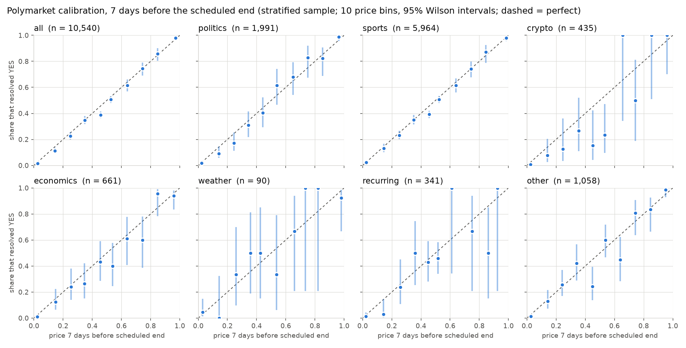

# Where are prediction markets least efficient?

A read-only measurement study of Kalshi and Polymarket. If a contract trades at 70 cents, the market says
"70% likely". This project tests whether those prices can be trusted, and where they break down.

Scope: measurement only. Public read-only data, no accounts, no API keys, no orders. Whatever comes out is
reported, including "these markets are efficient".

## Research questions (written before looking at any results)

This section was committed before any data was downloaded or analysed. Later changes to it are visible in
the git history and are listed under "Deviations" below.

### (a) Calibration

When a market says 70%, does it happen about 70% of the time?

- Sample: resolved binary markets (outcome exactly YES or NO; voided or 50/50 resolutions dropped).
  One observation per market: the first listed outcome ("Yes" in yes/no markets) and its price.
- Reference time `T` = the earlier of the scheduled end date and the actual close time. Price at horizon
  `h` = the last recorded price at or before `T - h`, for `h` = 1 day, 7 days and 30 days. The market must
  have a price within the 24 hours before `T - h`; markets younger than `h` at `T` are dropped for that
  horizon. Primary horizon: 7 days. 1 day and 30 days are secondary.
- Main sample: lifetime volume >= $1,000. Robustness: volume >= $50,000.
- Metrics: Brier score with its Murphy decomposition (reliability, resolution, uncertainty); calibration
  curve in 10 equal-width price bins with 95% Wilson intervals; logistic recalibration
  `logit P(YES) = a + b * logit(price)`. A calibrated market has `a = 0, b = 1`; tested jointly with a
  Wald test using standard errors clustered by event (outcomes of one event are not independent).
- By category: sports, politics, economics, weather, crypto, other, assigned from the venue's own tags by
  a fixed mapping in the code (`pm/data.py`).

### (b) Favorite-longshot bias

Are cheap contracts overpriced, as in betting markets?

- Same sample and prices as (a).
- Test: the slope `b` above. `b > 1` means true probabilities are more extreme than prices, i.e. longshots
  are overpriced and favorites underpriced. Two-sided test of `b = 1` at 5%, clustered by event.
- Descriptive: average overpricing of longshots, `mean(price - outcome)` over contracts priced at or below
  10 cents, with an event-clustered standard error.

### (c) Arbitrage inside one venue

How often does buying both YES and NO cost less than $1 after the official fee schedule, the spread and
slippage? How long do these gaps last?

- From order-book snapshots: for each binary market, walk the YES and NO asks to buy `q` of each, add the
  venue's official taker fee for every fill, and compare with the $1 payout. Report the share of snapshots
  with a positive net edge at the smallest allowed order size, the most profitable `q`, and the profit.
- Duration: consecutive snapshots with a positive edge form an episode. With snapshots every `N` minutes a
  duration is known only to within `N` minutes; shorter gaps are mostly missed. This is stated with every
  number.
- Gas and deposit/withdrawal costs are ignored; they can only shrink an edge.

(c') Added at design time, before any data: on both venues a single binary market's YES ask plus NO ask
below $1 implies a crossed book (Polymarket mirrors the YES and NO books; a Kalshi ask is one minus the
opposite bid), so (c) is expected to be close to never. The multi-outcome version is measured as well: for
an event whose outcomes are mutually exclusive and exhaustive, buying YES on every outcome pays exactly $1
(and NO on every outcome pays `n - 1`). Same fee and book-walking rules. Events that can still add outcomes
are excluded, since they are not exhaustive.

### (d) Arbitrage across venues

Is the same event priced differently on Kalshi and Polymarket, after fees?

- Only event pairs whose resolution rules are verified to match: same event, same resolution source, same
  cut-off date and time zone, same treatment of edge cases. The evidence for each pair (both rule texts and
  the comparison) is stored in `pairs/`; pairs with different rules are dropped and listed with the reason.
- Edge: buy YES on one venue and NO on the other at the walked asks plus both venues' taker fees, against
  the $1 payout. Same reporting as (c).

## Validation: every component is tested against a known answer

- Fee calculators reproduce the venues' published fee examples.
- Brier score and calibration on simulated forecasts that are calibrated by construction (must pass) and
  miscalibrated (must be detected).
- Arbitrage detector on synthetic order books with hand-computed edges, including walking the book and fees.
- The bias test rejects about 5% of the time on simulated unbiased markets with the same event clustering.

## First results (preliminary, 2026-10-17)



Sample: price histories of a random 5,744 of the 84,152 eligible markets in the first 108,900 resolved
markets the API returned (the full download is still running). The API does not list markets in random
order, so this sample is skewed in time: 83% resolved in 2025 and only 217 in 2026. Treat
every number here as preliminary. Full tables: `results/calibration_summary.csv`, `results/calibration_bins_7d.csv`.

Primary horizon, 7 days before close, main sample (volume >= $1,000): 2,018 markets in 1,570 events.

| | value |
|---|---|
| Brier score | 0.0889 (reliability 0.0023, resolution 0.0713, uncertainty 0.1586) |
| Recalibration slope `b` (1 = calibrated) | 1.138, SE 0.064; test of `b = 1`: p = 0.032 |
| Joint test `a = 0, b = 1` | p = 0.003 |
| Longshot overpricing, contracts <= 10 cents | 0.88 cents per contract, SE 0.30 (1,075 contracts) |

- (a) Prices are close to the diagonal overall: reliability, the miscalibration part of the Brier score,
  is 0.0023 against a score of 0.0889. Calibration is still statistically rejected at the primary horizon.
- (b) The direction is the favorite-longshot bias (`b > 1`): cheap contracts resolve YES slightly less
  often than their price says. The effect is under one cent per contract. It is strongest in sports
  (`b` = 1.35, SE 0.13, p = 0.007; longshots overpriced by 1.8 cents, SE 0.15).
- In the robustness sample (volume >= $50,000, 962 markets) the bias is not significant at 7 days
  (`b` = 1.065, SE 0.076, p = 0.39; longshot overpricing 0.32 cents, SE 0.48). The bias may be a feature
  of thin markets.
- Seven categories times three horizons is many tests. A single category with p near 0.05 is weak evidence.

(c) and (c'), first 5 snapshots (about 10 minutes): 58,442 single-market checks, none with YES + NO below
$1 after fees, as the mirrored books imply. Among 680 checks of exhaustive multi-outcome events, one event
("How many Fed rate cuts in 2026?", 13 outcomes) had YES asks summing below $1 after fees in all 5
snapshots: 1.1 cents per set at the minimum size, at most $0.16 in total over the available depth. The
event resolves on 2027-01-01, so the edge is about 5% a year on locked capital, roughly the risk-free rate.

## Data and venue terms

| | Polymarket | Kalshi |
|---|---|---|
| Resolved markets with outcomes | Gamma `GET /markets/keyset?closed=true` | `GET /markets`, `GET /historical/markets` |
| Price history | data-api `GET /v2/prices-history`: 3-hour and 12-hour buckets kept permanently, finer ones 30 days; only order-book (CLOB) markets, so the 2020-22 AMM markets have no history | candlesticks 1 min / 1 h / 1 day; settled markets before the archive cutoff via `/historical/...` |
| Live order books | CLOB `GET /book`, `POST /books` (500 tokens per call) | `GET /markets/{ticker}/orderbook` (bids only) |
| Published rate limits | per IP: Gamma `/markets` 300 per 10 s, `/v2/prices-history` 200 per 10 s, `/books` 500 per 10 s | token buckets per account tier (Basic: 200 tokens/s, 10 per request) |
| Fees | `C * rate * p(1-p)`, taker only, rate per market (0 to 0.07) | `0.07 * C * P(1-P)` rounded up to the cent for most markets |
| Terms | [Terms of Use](https://polymarket.com/tos) (effective 2026-08-11) forbid scraping the site and access or redistribution of the Data by capital-market firms and market-data distributors. Reading the documented public API for personal research is not in a prohibited category. | [Developer Agreement v1.1](https://assets.kalshi.com/Kalshi-Developer-Agreement.pdf), accepted by any API use: "Use of Kalshi APIs is expressly limited to facilitating a members own trading"; collecting, caching, aggregating or storing API data for other purposes is prohibited. The [Data Terms of Use](https://kalshi-public-docs.s3.amazonaws.com/kalshi-data-terms-of-service.pdf) also forbid compiling databases from Kalshi Data. |

Consequences: raw data is never committed. The repository holds code and aggregate results only, and
`data/` is git-ignored. **Kalshi is not queried** until written permission from Kalshi is obtained, so
question (d) and the Kalshi half of (c) are on hold. Kalshi parsing and fees are implemented and tested on
the published examples, so they are ready if permission arrives.

## Order-book collector (questions c and c')

`python -m pm.collect` takes a snapshot every 2 minutes of every open order-book market in every
Polymarket event with at least $10,000 traded in the last 24 hours (about 16,600 markets in 480 events on
2026-10-17), keeping 5 price levels a side. The universe is refreshed hourly. The published `/books` limit
would allow a snapshot every few seconds. Disk is the binding constraint (about 1.1 MB per compressed
snapshot, about 0.9 GB a day). Only the first outcome's book is stored: Polymarket derives the second
outcome's book from it. In a check of 347 markets with both books fetched in the same request, 346 were
exact mirrors (bid `p` = ask `1 - p`, same size). `scripts/install_collector.sh` installs it as a launchd
agent that starts at login and restarts if it dies. It only runs while the Mac is awake.

## How to run

```
python3 -m venv .venv && .venv/bin/pip install -r requirements.txt
.venv/bin/python tests/test_pm.py                       # 11 known-answer tests
.venv/bin/python scripts/fetch_history.py markets       # resolved markets, volume >= $1,000
.venv/bin/python scripts/fetch_history.py prices        # 3-hour price histories (resumable)
.venv/bin/python scripts/run_calibration.py             # (a) and (b) -> results/
.venv/bin/python scripts/plot_calibration.py            # -> calibration.png
./scripts/install_collector.sh                          # (c) collector as a background agent
```

## Deviations

Implementation details fixed after the questions were committed but before any result was computed:
prices of exactly 0 or 1 are clipped to [0.001, 0.999] (the smallest Polymarket tick) before taking logits;
a category is reported only if it has at least 30 events; Kalshi is excluded for the terms reason above.
